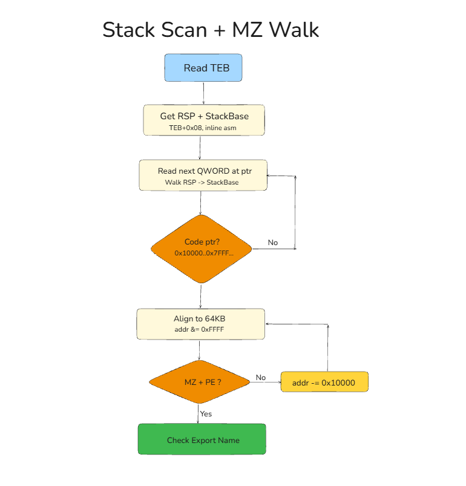
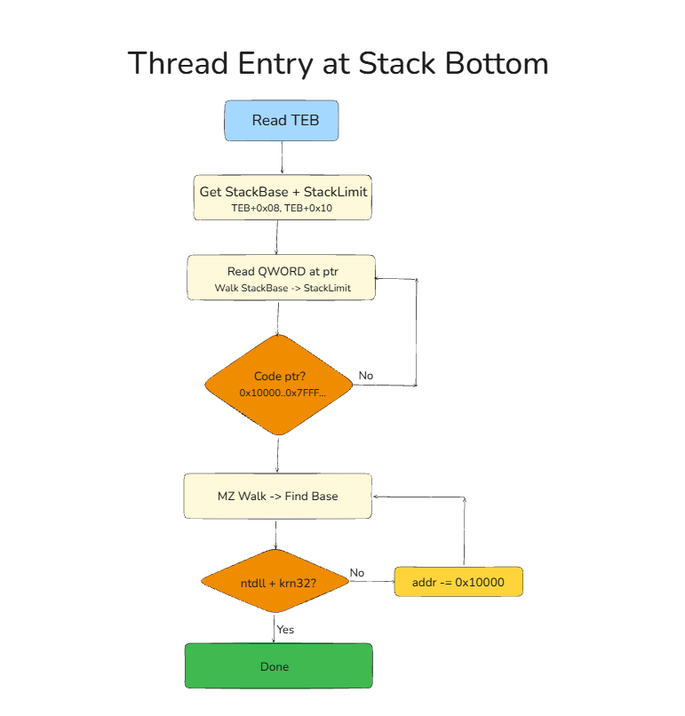
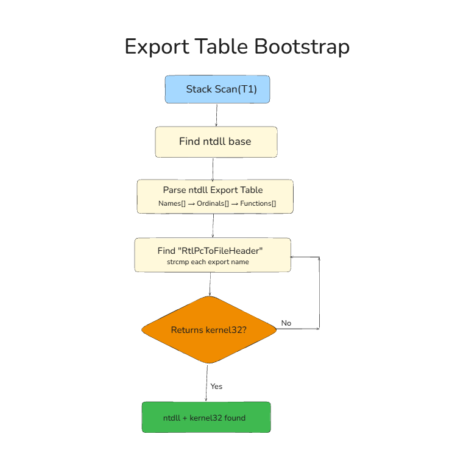
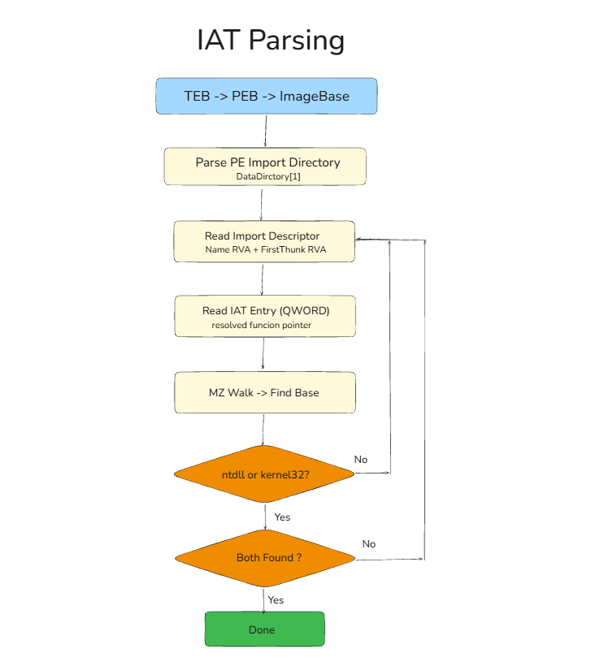
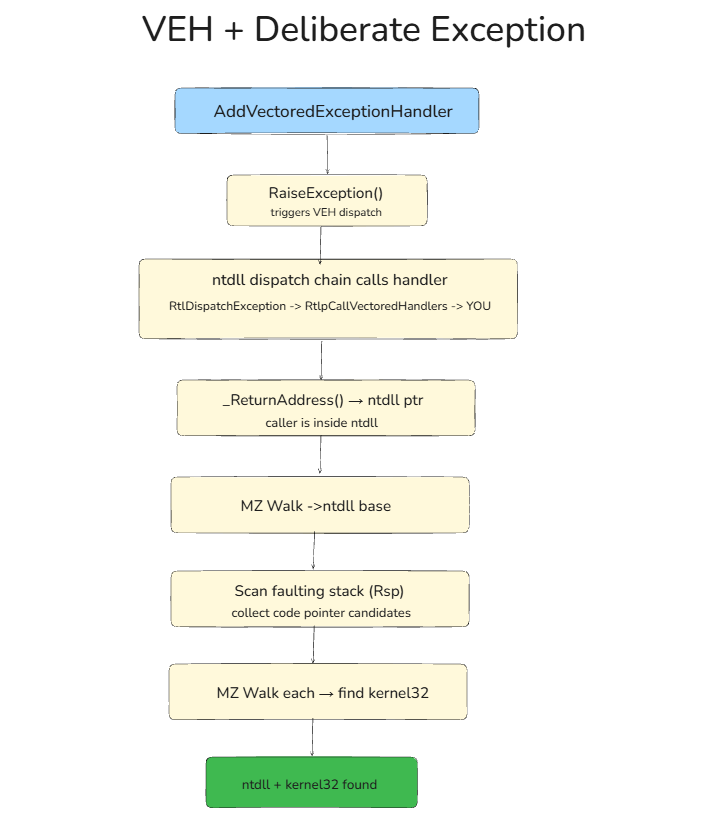

# Beyond PEB Walking: Alternative Ways to Find DLL Base Addresses and Resolve Functions at Runtime

If you've ever looked into how shellcode or position-independent code resolves Windows API functions at runtime, you've probably seen the classic approach: walk the `PEB→Ldr→InMemoryOrderModuleList` linked list to find loaded DLLs, then parse their export tables. It works. It's documented everywhere. And that's exactly the problem - every EDR, every sandbox, every analyst knows to look for it.

This post explores **five alternative techniques** for finding `ntdll.dll` and `kernel32.dll` base addresses without touching the PEB loader lists. Once we have kernel32's base, we walk its PE Export Table and resolve **`LoadLibraryW`** and **`GetProcAddress`** using **DJB2 hash matching** - no function name strings anywhere in the binary.

Why these two? Because once you have `LoadLibraryW` and `GetProcAddress`, you can load *any* DLL and resolve *any* function at runtime. That's the entire Windows API at your fingertips - from two function pointers that you found without ever touching `PEB→Ldr`.

We'll go through each technique with the actual C code, explain what every line does, and show how you can verify each step in WinDbg.

---

## Table of Contents

1. [The Foundation: What We're Building On](#the-foundation)
2. [The Building Blocks: Common Code](#the-building-blocks)
3. [Technique 1: Stack Scan + MZ Backward Walk](#technique-1-stack-scan--mz-backward-walk)
4. [Technique 2: Thread Entry at Stack Bottom](#technique-2-thread-entry-at-stack-bottom)
5. [Technique 3: Export Table Bootstrap](#technique-3-export-table-bootstrap)
6. [Technique 4: IAT Parsing](#technique-4-iat-parsing)
7. [Technique 5: VEH + Deliberate Exception](#technique-5-veh--deliberate-exception)
8. [The Payoff: DJB2 Hash-Based Function Resolution](#the-payoff-djb2-hash-based-function-resolution)
9. [The Endgame: LoadLibraryW + GetProcAddress = Everything](#the-endgame)
10. [Putting It All Together](#putting-it-all-together)

---

## The Foundation

Before we dive in, let's establish the three pieces of Windows internals knowledge that every technique relies on.

### 1. The Thread Environment Block (TEB)

Every thread in a Windows process has a TEB. On x64, the `gs` segment register at offset `0x30` points to it. In C code, `NtCurrentTeb()` gives you the pointer portably.

The TEB fields we care about:

```
Offset   Field              What It Gives Us
──────   ─────              ────────────────────────────────────
+0x008   StackBase          Top of the stack (highest address)
+0x010   StackLimit         Bottom of the stack (lowest address)
+0x060   PEB pointer        Points to the Process Environment Block
```

In WinDbg, you can dump these right now:

```
0:000> dq @$teb+0x08 L1       ; StackBase
0:000> dq @$teb+0x10 L1       ; StackLimit
0:000> dq @$teb+0x60 L1       ; PEB
```

In C:

```c
ULONG_PTR teb       = (ULONG_PTR)NtCurrentTeb();
ULONG_PTR stackBase = *(ULONG_PTR *)(teb + 0x08);
ULONG_PTR stackLimit = *(ULONG_PTR *)(teb + 0x10);
```

No API calls, no PEB→Ldr, no linked lists. Just reading from a segment register offset.

### 2. The 64KB Alignment Rule

Windows loads every PE image at a 64KB-aligned address. This is the system allocation granularity. It means every DLL's base address ends in `0x0000`.

Why does this matter? Because if you have *any* code pointer inside a DLL, you can find the DLL's base by:

1. Masking to the nearest 64KB boundary: `addr & ~0xFFFF`
2. Checking if the MZ signature (`0x5A4D`) is there
3. If not, subtracting `0x10000` and checking again
4. Repeating until you find it

A DLL that's 1MB in size means at most ~16 backward steps. In practice, you usually hit it in 1-5 steps.

### 3. The MZ + PE Signature Validation

Finding `0x5A4D` ("MZ") at a 64KB boundary isn't enough - you could hit coincidental bytes. To confirm it's a real PE:

1. Read the DWORD at offset `+0x3C` - this is `e_lfanew`, the offset to the PE header
2. Check that `e_lfanew` is sane (positive, less than `0x1000`)
3. Read the DWORD at `base + e_lfanew` - it should be `0x00004550` ("PE\0\0")

If both checks pass, you're standing on a valid PE image.

Here's what this looks like in code - this `FindModuleBase` function appears in every technique:

```c
static ULONG_PTR FindModuleBase(ULONG_PTR addr)
{
    addr &= ~((ULONG_PTR)0xFFFF);          // align to 64KB
    for (int i = 0; i < 2048; i++) {
        if (Readable(addr, 0x1000)) {        // don't touch unmapped memory
            if (*(USHORT *)addr == IMAGE_DOS_SIGNATURE) {      // "MZ"?
                LONG lfanew = *(LONG *)(addr + 0x3C);
                if (lfanew > 0 && lfanew < 0x1000 &&
                    *(DWORD *)(addr + lfanew) == IMAGE_NT_SIGNATURE)  // "PE\0\0"?
                    return addr;             // found it
            }
        }
        if (addr < 0x10000) break;
        addr -= 0x10000;                     // step back one 64KB block
    }
    return 0;
}
```

And the `Readable` check uses `VirtualQuery` to avoid crashing on unmapped pages:

```c
static int Readable(ULONG_PTR addr, SIZE_T sz)
{
    MEMORY_BASIC_INFORMATION mbi;
    if (!VirtualQuery((LPCVOID)addr, &mbi, sizeof(mbi))) return 0;
    if (mbi.State != MEM_COMMIT) return 0;
    if (mbi.Protect & (PAGE_NOACCESS | PAGE_GUARD)) return 0;
    return ((ULONG_PTR)mbi.BaseAddress + mbi.RegionSize) >= (addr + sz);
}
```

### Identifying Which Module You Found

Once you have a PE base, how do you know if it's ntdll or kernel32? The PE's Export Directory contains the DLL's own name:

```c
static const char *GetModuleName(ULONG_PTR base)
{
    IMAGE_DOS_HEADER *dos = (IMAGE_DOS_HEADER *)base;
    IMAGE_NT_HEADERS *nt  = (IMAGE_NT_HEADERS *)(base + dos->e_lfanew);
    DWORD rva = nt->OptionalHeader.DataDirectory[IMAGE_DIRECTORY_ENTRY_EXPORT].VirtualAddress;
    if (!rva) return NULL;
    IMAGE_EXPORT_DIRECTORY *exp = (IMAGE_EXPORT_DIRECTORY *)(base + rva);
    return exp->Name ? (const char *)(base + exp->Name) : NULL;
}
```

Call it and compare: `"ntdll.dll"` or `"KERNEL32.DLL"`. No PEB, no Ldr, just PE parsing.

In WinDbg, you'd do the same thing manually:

```
; Given a PE base at <BASE>:
0:000> dd <BASE>+3c L1                          ; read e_lfanew
0:000> dd <BASE>+<e_lfanew>+88 L2               ; Export Directory RVA (DataDirectory[0])
0:000> dd <BASE>+<ExportDir_RVA>+0c L1          ; Name RVA inside Export Directory
0:000> da <BASE>+<Name_RVA>                      ; print the DLL name string
```

Now let's look at five different ways to get that initial code pointer.

---

## Technique 1: Stack Scan + MZ Backward Walk

**Core idea:** Your thread's call stack is full of return addresses. Each return address points into the DLL that called the next function. Read the stack as raw memory, take each pointer-sized value, and MZ-walk backward from it.

### Why it works

When function A in `kernel32.dll` calls function B in your exe, the CPU pushes the return address (inside kernel32) onto the stack. That address is still there when your code runs. Every thread has a chain like:

```
ntdll!RtlUserThreadStart → kernel32!BaseThreadInitThunk → your_main
```

So the stack *always* contains pointers into both ntdll and kernel32.

### The code

```c
int main(void)
{
    ULONG_PTR teb       = (ULONG_PTR)NtCurrentTeb();
    ULONG_PTR stackBase = *(ULONG_PTR *)(teb + 0x08);  // TEB.StackBase
    ULONG_PTR rsp       = GET_RSP();                     // current stack pointer

    ULONG_PTR ntdll = 0, k32 = 0;

    // Walk from current RSP up toward StackBase
    for (ULONG_PTR p = rsp; p < stackBase; p += sizeof(ULONG_PTR)) {
        ULONG_PTR val = *(ULONG_PTR *)p;

        // Filter: user-mode code range only
        if (val < 0x10000 || val > 0x7FFFFFFFFFFF) continue;

        // Try to MZ-walk backward from this value
        ULONG_PTR base = FindModuleBase(val);
        if (!base) continue;

        // Identify by export name
        const char *name = GetModuleName(base);
        if (name && _stricmp(name, "ntdll.dll") == 0)    ntdll = base;
        if (name && _stricmp(name, "KERNEL32.DLL") == 0)  k32  = base;
    }
    // ntdll and k32 now hold the base addresses
}
```

### What's happening step by step

1. **Get stack boundaries** from TEB - no API calls
2. **Read RSP** via inline assembly (`mov %%rsp, %0` on GCC)
3. **Iterate every 8-byte value** on the stack from RSP to StackBase
4. **Filter out non-pointers** - anything below `0x10000` is definitely not a code address, and anything above `0x7FFFFFFFFFFF` is kernel space
5. **MZ-walk** each candidate backward to find its PE base
6. **Check the export name** to identify which DLL it belongs to

### Verify in WinDbg

```
0:000> dps @rsp L100
```

You'll see values like `00007ffd'd92e7818 ntdll!LdrInitializeThunk+0xe`. That `00007ffd'd92e7818` is exactly the kind of value our code picks up. WinDbg shows the symbol because it has debug info - our code doesn't need it.



---

## Technique 2: Thread Entry at Stack Bottom

**Core idea:** Don't scan the whole stack. Go straight to the bottom. Every user-mode thread's deepest two frames are always `ntdll!RtlUserThreadStart` and `kernel32!BaseThreadInitThunk`. They're sitting right near `StackBase`.

### Why it works

The Windows loader sets up every thread's call chain identically:

```
ntdll!RtlUserThreadStart      ← deepest frame (address is inside ntdll)
  kernel32!BaseThreadInitThunk ← second deepest (address is inside kernel32)
    your entry point
```

This is baked into the Windows thread creation mechanism. By scanning from `StackBase` *downward*, you hit ntdll and kernel32 first - in 1-2 hits instead of scanning potentially hundreds of stack slots.

### The code

```c
// Scan from bottom of stack upward (StackBase down toward StackLimit)
for (ULONG_PTR p = stackBase - sizeof(ULONG_PTR); p >= stackLimit; p -= sizeof(ULONG_PTR)) {
    ULONG_PTR val = *(ULONG_PTR *)p;
    if (val < 0x10000 || val > 0x7FFFFFFFFFFF) continue;

    ULONG_PTR base = FindModuleBase(val);
    if (!base) continue;

    const char *name = GetModuleName(base);
    if (!name) continue;

    if (!ntdll && _stricmp(name, "ntdll.dll") == 0)    ntdll = base;
    if (!k32   && _stricmp(name, "KERNEL32.DLL") == 0)  k32   = base;
    if (ntdll && k32) break;   // got both, done
}
```

The difference from Technique 1: we start from `StackBase` and go down, so the very first code pointers we encounter are the thread-entry frames.

### Verify in WinDbg

```
0:000> k
 # RetAddr               Call Site
00 ...                    your_exe!main
01 ...                    ucrtbase!...
02 00007ffd`d84adda7      KERNEL32!BaseThreadInitThunk+0x17
03 00007ffd`d933ee4c      ntdll!RtlUserThreadStart+0x2c
```

Frames 02 and 03 are always there. Their return addresses are what we're picking up.



---

## Technique 3: Export Table Bootstrap

**Core idea:** Find ntdll via stack scanning, then *manually parse its export table* to locate `RtlPcToFileHeader` - an ntdll function that maps any code pointer to its module base. Use that to find kernel32.

This is a "pull yourself up by your bootstraps" approach: find one DLL by brute force, hand-roll your own PE export parser from its raw export table, and use the resolved function to find everything else.

### Important: "ManualGetProcAddress" is NOT kernel32's GetProcAddress

This needs to be crystal clear. The function we call `ManualGetProcAddress` in the code is **our own hand-written PE export table parser**. It has nothing to do with `kernel32!GetProcAddress`. We don't have kernel32 yet - that's what we're trying to find!

Here's what's actually happening:

1. We find ntdll's base address via stack scanning (same as Technique 1)
2. ntdll is a PE file mapped in memory. Its PE header contains an Export Directory with three parallel arrays listing every function it exports
3. We **manually walk those arrays ourselves** - reading raw memory, comparing strings, following RVA offsets
4. We find `RtlPcToFileHeader` by iterating ntdll's export names until we hit a match
5. We call `RtlPcToFileHeader` to find kernel32

At no point do we call `kernel32!GetProcAddress`. We're doing the exact same work that `GetProcAddress` does internally - parsing PE export tables - but we're doing it ourselves, by hand, from raw memory. The name `ManualGetProcAddress` just describes what the function *does*, not where it comes from.

### The hand-rolled PE export parser

The PE Export Directory has three parallel arrays:

```
AddressOfNames       → array of RVAs to function name strings
AddressOfNameOrdinals → array of WORDs (indices into AddressOfFunctions)
AddressOfFunctions   → array of RVAs to the actual function code
```

To find a function by name:
1. Walk `AddressOfNames`, comparing each string
2. When you find a match at index `i`, read `AddressOfNameOrdinals[i]` → ordinal
3. Read `AddressOfFunctions[ordinal]` → function RVA
4. Add the DLL base → you have the function pointer

```c
static ULONG_PTR ManualGetProcAddress(ULONG_PTR base, const char *funcName)
{
    IMAGE_DOS_HEADER *dos = (IMAGE_DOS_HEADER *)base;
    IMAGE_NT_HEADERS *nt  = (IMAGE_NT_HEADERS *)(base + dos->e_lfanew);
    IMAGE_DATA_DIRECTORY *dir = &nt->OptionalHeader.DataDirectory[IMAGE_DIRECTORY_ENTRY_EXPORT];
    if (!dir->VirtualAddress) return 0;

    IMAGE_EXPORT_DIRECTORY *exp = (IMAGE_EXPORT_DIRECTORY *)(base + dir->VirtualAddress);
    DWORD *names     = (DWORD *)(base + exp->AddressOfNames);
    WORD  *ordinals  = (WORD  *)(base + exp->AddressOfNameOrdinals);
    DWORD *functions = (DWORD *)(base + exp->AddressOfFunctions);

    for (DWORD i = 0; i < exp->NumberOfNames; i++) {
        if (strcmp((const char *)(base + names[i]), funcName) == 0)
            return base + functions[ordinals[i]];
    }
    return 0;
}
```

This is pure PE parsing. We're reading the mapped ntdll image's bytes directly - `base + names[i]` walks to the function name string in ntdll's memory, and `base + functions[ordinals[i]]` is the function's actual address. No Windows API involved.

### Using it

```c
// Step 1: Find ntdll via stack scan + MZ walk (same as Technique 1)
ULONG_PTR ntdllBase = /* ... found via stack scan ... */;

// Step 2: Manually parse ntdll's export table to find RtlPcToFileHeader
//         This is US walking the PE, not calling kernel32!GetProcAddress
typedef PVOID (WINAPI *fn_RtlPcToFileHeader)(PVOID, PVOID *);
ULONG_PTR fnAddr = ManualGetProcAddress(ntdllBase, "RtlPcToFileHeader");
fn_RtlPcToFileHeader pResolve = (fn_RtlPcToFileHeader)fnAddr;

// Step 3: Use it to find kernel32 from any stack code pointer
for (ULONG_PTR p = rsp; p < stackBase; p += sizeof(ULONG_PTR)) {
    ULONG_PTR val = *(ULONG_PTR *)p;
    PVOID imageBase = NULL;
    pResolve((PVOID)val, &imageBase);
    // If imageBase != ntdll, check if it's kernel32 via export name
}
```

`RtlPcToFileHeader` is a legitimate ntdll export that does exactly what `FindModuleBase` does, but using the loader's internal data structures. Once you have it, finding any other module from a code pointer is a single function call.

### Verify in WinDbg

You can walk the export table manually:

```
; Search ntdll for the function name string
0:000> s -a <ntdll_base> L?200000 "RtlPcToFileHeader"
; Then resolve through names → ordinals → functions arrays
```

Or just verify the resolved address:

```
0:000> u <resolved_address> L1
ntdll!RtlPcToFileHeader:
```



---

## Technique 4: IAT Parsing

**Core idea:** Your executable's PE header has an Import Directory listing every DLL it imports from, and the Import Address Table (IAT) holds *resolved* function pointers into those DLLs. Read the IAT, MZ-walk from those pointers.

### Getting the exe's base without Ldr

We use `PEB.ImageBaseAddress` - a single field at `PEB+0x10`. The PEB pointer comes from `TEB+0x60`. No linked list walking:

```c
ULONG_PTR teb       = (ULONG_PTR)NtCurrentTeb();
ULONG_PTR peb       = *(ULONG_PTR *)(teb + 0x60);     // TEB+0x60 = PEB
ULONG_PTR imageBase = *(ULONG_PTR *)(peb + 0x10);      // PEB+0x10 = ImageBaseAddress
```

### Parsing the Import Directory

The Import Directory is `DataDirectory[1]` in the PE Optional Header. Each entry is an `IMAGE_IMPORT_DESCRIPTOR`:

```
+0x00  OriginalFirstThunk  → Import Name Table (function names/hints)
+0x0C  Name                → RVA to the DLL name string ("KERNEL32.dll")
+0x10  FirstThunk          → RVA to the IAT (resolved pointers at runtime)
```

The IAT is key: at load time, Windows fills `FirstThunk` with the actual virtual addresses of the imported functions. Each QWORD in that array points into the imported DLL.

```c
IMAGE_IMPORT_DESCRIPTOR *imp = (IMAGE_IMPORT_DESCRIPTOR *)(imageBase + importDir->VirtualAddress);

for (; imp->Name != 0; imp++) {
    const char *dllName = (const char *)(imageBase + imp->Name);
    ULONG_PTR  *iat     = (ULONG_PTR *)(imageBase + imp->FirstThunk);

    // iat[0], iat[1], ... are resolved function pointers inside that DLL
    ULONG_PTR dllBase = FindModuleBase(iat[0]);
    // Now identify it via export name...
}
```

### The API set forwarding gotcha

Modern Windows uses "API sets" (`api-ms-win-core-*`) to redirect imports. Your exe says it imports from `KERNEL32.dll`, but the first IAT entry might actually resolve into `ntdll.dll` because that particular function is forwarded. The code handles this by checking multiple IAT slots, not just the first one, and also matching against the import descriptor's name field.

### Chaining: finding ntdll through kernel32

MinGW-compiled executables often don't import ntdll directly. But kernel32 does - it imports heavily from ntdll. So the code chains: find kernel32 from the exe's IAT, then find ntdll from kernel32's IAT:

```c
WalkImports(imageBase, &ntdll, &k32, "EXE");

if (!ntdll && k32) {
    // ntdll not directly imported - check kernel32's own imports
    WalkImports(k32, &ntdll, &k32, "K32");
}
```

### Verify in WinDbg

```
; Get your exe's base
0:000> dq @$teb+0x60 L1       ; PEB
0:000> dq <PEB>+0x10 L1       ; ImageBaseAddress

; Dump its import descriptors
0:000> !dh <imageBase> -f

; Or read IAT entries directly
0:000> dqs <imageBase>+<FirstThunk_RVA> L10
; Shows resolved function pointers with symbols
```



---

## Technique 5: VEH + Deliberate Exception

**Core idea:** Register a Vectored Exception Handler, then deliberately raise an exception. The VEH handler is called from `ntdll!RtlpCallVectoredHandlers` - so the handler's return address points straight into ntdll. The faulting stack still has kernel32 frames from the thread entry chain.

### The exception dispatch chain

When you call `RaiseException()`, this happens:

```
Your code → RaiseException()
  → KERNEL32!RaiseException
    → ntdll!RtlRaiseException
      → ntdll!RtlDispatchException
        → ntdll!RtlpCallVectoredHandlers
          → YOUR VEH HANDLER          ← return address = inside ntdll!
```

Inside the handler, `__builtin_return_address(0)` (GCC) or `_ReturnAddress()` (MSVC) gives you the address of the instruction in ntdll that called your handler. That's a code pointer inside ntdll - MZ-walk from it.

### The code

```c
static LONG CALLBACK VehHandler(PEXCEPTION_POINTERS ep)
{
    if (ep->ExceptionRecord->ExceptionCode != TRIGGER_CODE)
        return EXCEPTION_CONTINUE_SEARCH;

    // Return address = inside ntdll's exception dispatch
    g_dispatchAddr = RET_ADDR();

    // The faulting stack has kernel32 frames - collect candidates
    ULONG_PTR faultRsp  = ep->ContextRecord->Rsp;
    ULONG_PTR teb       = (ULONG_PTR)NtCurrentTeb();
    ULONG_PTR stackBase = *(ULONG_PTR *)(teb + 0x08);

    for (ULONG_PTR p = faultRsp; p < stackBase; p += sizeof(ULONG_PTR)) {
        ULONG_PTR val = *(ULONG_PTR *)p;
        if (val > 0x10000 && val < 0x7FFFFFFFFFFF)
            g_candidates[g_candidateCount++] = val;
    }

    return EXCEPTION_CONTINUE_EXECUTION;  // resume - no crash
}
```

The `EXCEPTION_CONTINUE_EXECUTION` return is crucial - execution resumes right after `RaiseException()`. No crash, no SEH, works on both MSVC and MinGW.

```c
int main(void)
{
    PVOID h = AddVectoredExceptionHandler(1, VehHandler);
    RaiseException(0xDEAD0001, 0, 0, NULL);
    // Execution continues here after the handler returns
    RemoveVectoredExceptionHandler(h);

    // g_dispatchAddr now points into ntdll
    ULONG_PTR ntdll = FindModuleBase(g_dispatchAddr);

    // g_candidates[] has stack values - scan for kernel32
    // ...
}
```

### Verify in WinDbg

```
0:000> bp ntdll!RtlpCallVectoredHandlers
0:000> g
; When it breaks:
0:000> k
; Frame 0 will be inside ntdll's dispatch machinery
; Lower frames show kernel32!BaseThreadInitThunk
```



---

## The Payoff: DJB2 Hash-Based Function Resolution

We now have `kernel32.dll`'s base address. The next step: resolve `LoadLibraryW` and `GetProcAddress` from it. But we don't want function name strings like `"LoadLibraryW"` or `"GetProcAddress"` in our binary - that's an easy signature for static analysis.

### DJB2 hashing

DJB2 is a simple, fast hash function. We pre-compute the hash of the function name we want and hardcode it as a constant:

```c
#define HASH_LoadLibraryW   0xBFAD0E5F5FBFF111ULL
#define HASH_GetProcAddress 0x996ED96FCF31BB1FULL
```

The hash function itself:

```c
static ULONG_PTR Djb2Hash(const char *str)
{
    ULONG_PTR h = 5381;
    while (*str)
        h = ((h << 5) + h) + (unsigned char)*str++;
    return h;
}
```

This computes `hash = hash * 33 + char` for each character. It's fast, has decent distribution, and the output is a 64-bit value (on x64) making collisions extremely unlikely.

### The resolver

Walk the export table, hash each export name on the fly, compare against the target hash:

```c
static ULONG_PTR ResolveByHash(ULONG_PTR base, ULONG_PTR hash)
{
    if (!base || !Readable(base, 0x1000)) return 0;

    IMAGE_DOS_HEADER *dos = (IMAGE_DOS_HEADER *)base;
    IMAGE_NT_HEADERS *nt  = (IMAGE_NT_HEADERS *)(base + dos->e_lfanew);
    IMAGE_DATA_DIRECTORY *dir = &nt->OptionalHeader.DataDirectory[IMAGE_DIRECTORY_ENTRY_EXPORT];
    if (!dir->VirtualAddress) return 0;

    IMAGE_EXPORT_DIRECTORY *exp = (IMAGE_EXPORT_DIRECTORY *)(base + dir->VirtualAddress);
    DWORD *names     = (DWORD *)(base + exp->AddressOfNames);
    WORD  *ordinals  = (WORD  *)(base + exp->AddressOfNameOrdinals);
    DWORD *functions = (DWORD *)(base + exp->AddressOfFunctions);

    for (DWORD i = 0; i < exp->NumberOfNames; i++) {
        if (Djb2Hash((const char *)(base + names[i])) == hash)
            return base + functions[ordinals[i]];
    }
    return 0;
}
```

### Resolving LoadLibraryW and GetProcAddress

Both functions live in `kernel32.dll`, so we resolve them both from the same base:

```c
ULONG_PTR pLoadLib  = ResolveByHash(k32, HASH_LoadLibraryW);
ULONG_PTR pGetProc  = ResolveByHash(k32, HASH_GetProcAddress);

// Cast to callable function pointers:
typedef HMODULE (WINAPI *fn_LoadLibraryW)(LPCWSTR);
typedef FARPROC (WINAPI *fn_GetProcAddress)(HMODULE, LPCSTR);

fn_LoadLibraryW   pLoadLibraryW   = (fn_LoadLibraryW)pLoadLib;
fn_GetProcAddress pGetProcAddress = (fn_GetProcAddress)pGetProc;
```

### What's in the binary

The only things in the compiled binary are the numeric constants `0xBFAD0E5F5FBFF111` and `0x996ED96FCF31BB1F`. No `"LoadLibraryW"` or `"GetProcAddress"` strings anywhere. Static analysis tools looking for import names or known API strings won't find them. The hashes are computed at compile time and hardcoded into the binary as `#define` constants.

### How to generate hashes for other functions

Write a small utility:

```c
#include <stdio.h>
typedef unsigned long long u64;
u64 djb2(const char *s) { u64 h = 5381; while (*s) h = ((h << 5) + h) + (unsigned char)*s++; return h; }
int main(int argc, char **argv) {
    for (int i = 1; i < argc; i++)
        printf("#define HASH_%-30s 0x%llXULL\n", argv[i], djb2(argv[i]));
}
```

Run it: `hash_gen.exe LoadLibraryW GetProcAddress VirtualAlloc CreateRemoteThread`

### Verify in WinDbg

Once you have the resolved addresses, confirm them in WinDbg:

```
0:000> u <LoadLibraryW_addr> L1
KERNEL32!LoadLibraryW:
...

0:000> u <GetProcAddress_addr> L1
KERNEL32!GetProcAddress:
...
```

The addresses match. We resolved functions from kernel32's base using only PE parsing and hash matching.

---

## The Endgame: LoadLibraryW + GetProcAddress = Everything

This is where the whole thing pays off. Think about what we now have:

- **`LoadLibraryW`** - can load *any* DLL by name into the process
- **`GetProcAddress`** - can resolve *any* exported function from *any* loaded DLL

With these two function pointers, you have the keys to the entire Windows API. Need `VirtualAlloc`? `CreateRemoteThread`? `WriteProcessMemory`? Anything from `user32.dll`, `ws2_32.dll`, `advapi32.dll`? You can get it:

```c
// Load any DLL
HMODULE hUser32 = pLoadLibraryW(L"user32.dll");

// Resolve any function from it
FARPROC pMessageBoxW = pGetProcAddress(hUser32, "MessageBoxW");

// Call it
typedef int (WINAPI *fn_MessageBoxW)(HWND, LPCWSTR, LPCWSTR, UINT);
((fn_MessageBoxW)pMessageBoxW)(NULL, L"Hello", L"From Runtime Resolution", MB_OK);
```

### Why not resolve everything by hash?

You *could* hardcode DJB2 hashes for every function you need and resolve them all via PE export parsing. But:

1. You'd need the DLL to already be loaded (you can't hash-resolve from a DLL that isn't in memory)
2. You'd need to find each DLL's base separately
3. You'd need a new hash constant for every function

With `LoadLibraryW` + `GetProcAddress`, you need exactly two hashes total. Everything else is a runtime string resolution through the standard API - which is perfectly normal process behavior.

---

### Summary table

```
Technique            Source of Code Pointer         Touches PEB Ldr?
──────────────────   ─────────────────────────────  ────────────────
1. Stack Scan        Stack return addresses          No
2. Stack Bottom      Thread entry frames at bottom   No
3. Export Bootstrap  Stack → ntdll → RtlPcTo...      No
4. IAT Parsing       Resolved IAT entries            PEB.ImageBase only
5. VEH Exception     VEH handler return address      No
```

Every technique ends the same way: DLL base → PE export table → DJB2 hash match → `LoadLibraryW` + `GetProcAddress` → full API access. The only difference is how you get that first code pointer.

### Building the code

All five techniques compile with MinGW:

```
make          # build all 5
make run      # build and run all 5
make run1     # just technique 1
```

Sample output (addresses will differ due to ASLR):

```
[*] ntdll.dll    : 0x7FFDD92C0000
[*] kernel32.dll : 0x7FFDD8480000

[*] DJB2 Function Resolution (hardcoded hashes, no strings in binary):
[*] LoadLibraryW   (hash 0xBFAD0E5F5FBFF111) : 0x7FFDD84BF6C0
[*] GetProcAddress (hash 0x996ED96FCF31BB1F) : 0x7FFDD84B3140
```

Both functions resolved. Both addresses verified against WinDbg symbols. No PEB→Ldr linked list was walked. No function name strings in the binary. And from here, you can resolve anything.

---

## Key Takeaways

1. **The PEB→Ldr linked list is not the only path.** The stack, the IAT, the exception dispatch chain, and the TEB all contain enough information to bootstrap module discovery.

2. **The 64KB alignment rule + MZ/PE validation is the universal primitive.** Every technique reduces to: "get a code pointer inside a DLL, then walk backward."

3. **PE export tables are self-describing.** You don't need the real `GetProcAddress` to parse exports - the data is right there in the mapped image. Walk the arrays yourself. That's what our `ManualGetProcAddress` and `ResolveByHash` functions do - pure memory reads, no API calls.

4. **DJB2 hashing removes string signatures.** The binary contains `0xBFAD0E5F5FBFF111`, not `"LoadLibraryW"`. Same resolution, no string artifacts.

5. **Two function pointers unlock everything.** Once you have `LoadLibraryW` and `GetProcAddress` from kernel32, you can load any DLL and resolve any function. You don't need to hash every API - just these two.

6. **These techniques compose.** Technique 3 chains Technique 1 into export parsing into `RtlPcToFileHeader` calls. Technique 4 chains through kernel32's IAT to find ntdll. The building blocks are modular.

All source code is available in the technique folders alongside this post. Compile, run, step through in WinDbg, and study how each piece fits together.
